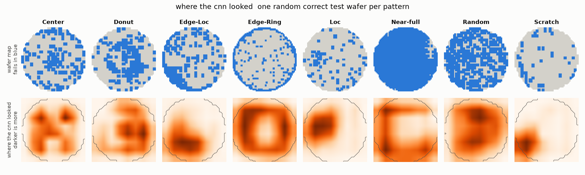
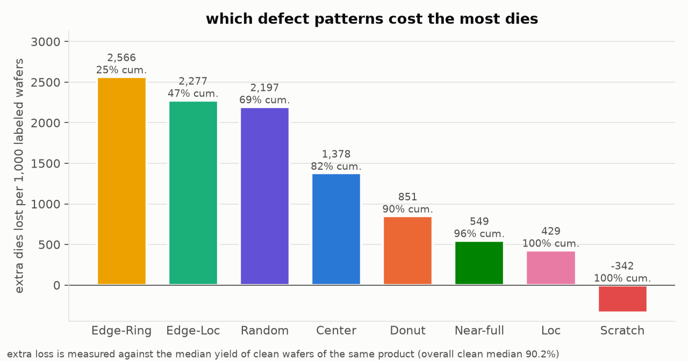
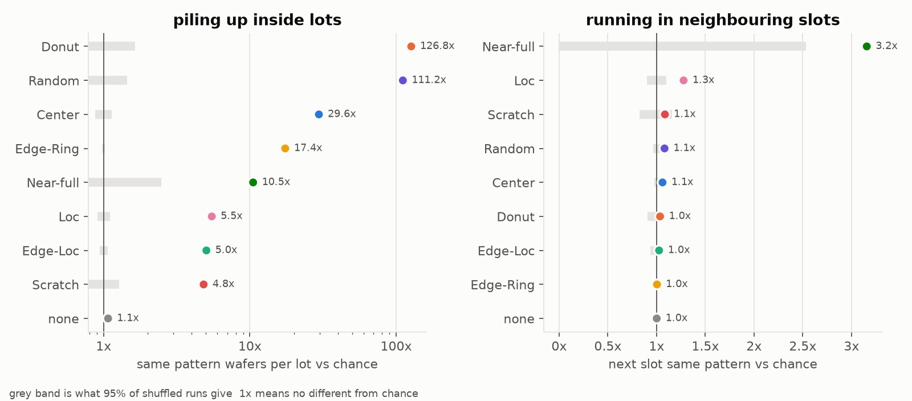
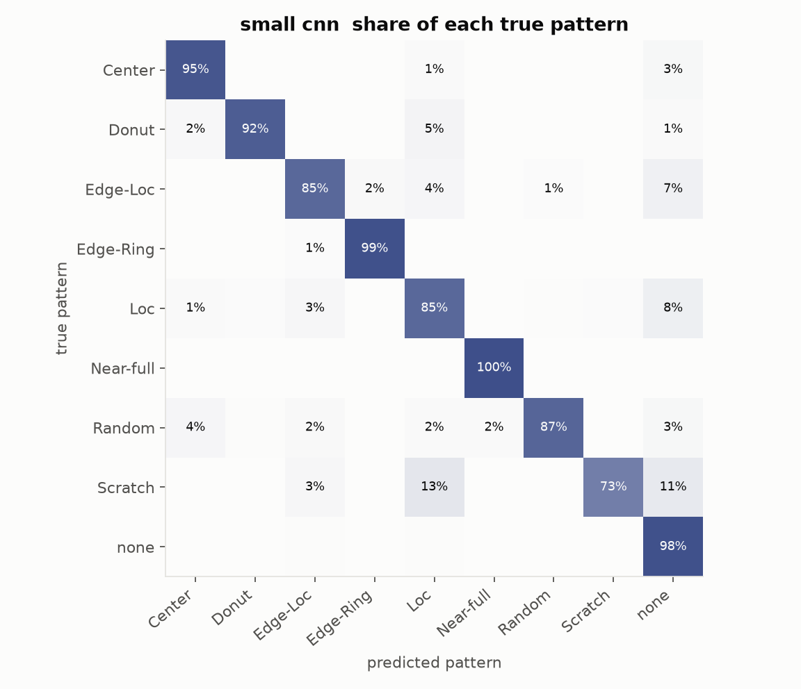
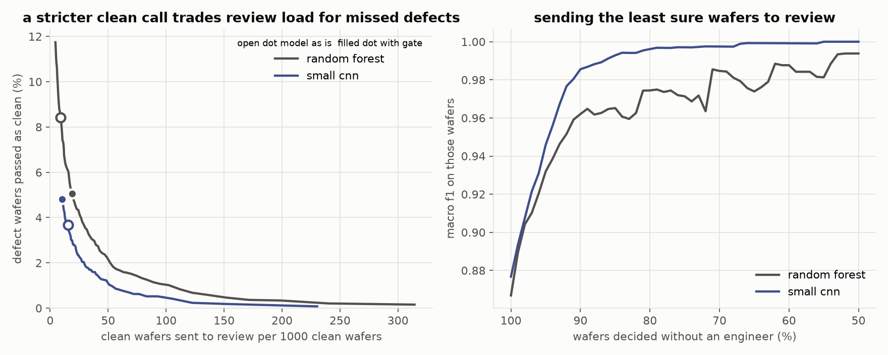
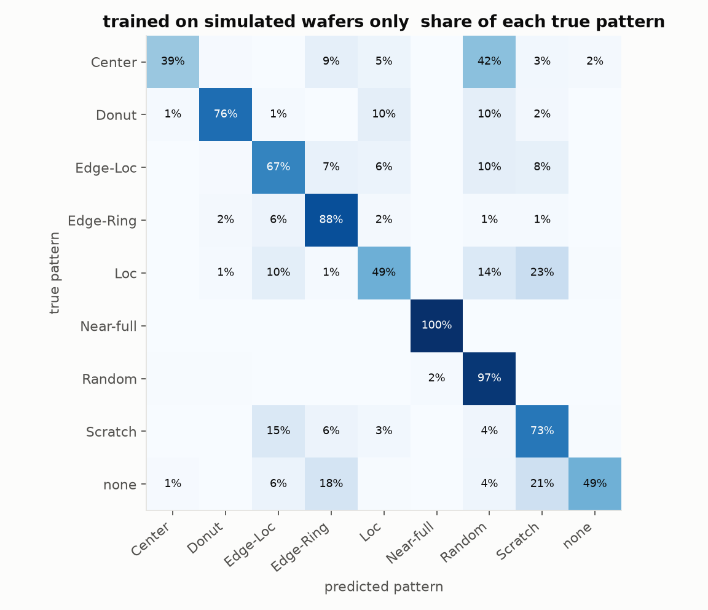

<a name="wm811k"></a>
<a name="wm-811k-wafer-map-yield-analysis"></a>

# Wafer defects and yield loss in WM-811K

<p align="center">
  <a href="#overview">Overview</a> · <a href="#data">Data</a> · <a href="#method">Method</a> · <a href="#results">Results</a> · <a href="#limits">Limits</a> · <a href="#usage">Usage</a> · <a href="#references">References</a> · <a href="#terms">Terms</a>
</p>

A neural network I trained in 47 minutes on my Mac outscored two Claude models and GPT at identifying defects on 180 wafer maps. Each map shows which chips on a disk of silicon failed electrical testing. My network learned from 121,072 labeled maps from other production batches. Claude and GPT got the test images and written descriptions of the patterns, with no labeled examples.

On the full held-out test of 25,939 wafers, my network scored 0.877 on macro-F1, which gives each label equal weight. On the 180-wafer sample it scored 0.916, ahead of Claude Fable at 0.786. The sample included 20 wafers from each of eight defect patterns and 20 labeled clean in WM-811K. Fable and GPT Luna each recognized all 20 scratches, Claude Opus recognized 19, and my network recognized 15.

## Key results

- **Missed defects.** Of the 3,832 wafers with a recorded defect pattern in the full test set, my network classified 141 as clean. A random forest classified 323 as clean. Those wafers would skip review if an engineer relied on the model’s call.
- **Simulated wafers.** I built a [simulator](docs/simulator.md) that can put a scratch on a virtual wafer at any angle. A model trained on 27,000 of my simulated maps mistook about one in five real wafers labeled clean for a scratched wafer.
- **Chip loss at the edge.** I used clean-wafer yields to estimate how many more chips failed than expected. Among defect patterns with excess failures, the two edge patterns accounted for [47% of the total](#yield-loss-by-pattern), about 838,000 chips.

<a name="example-maps"></a>



The top row shows electrical test results. Each blue square is a failed chip. The bottom row shows the network’s response to the same wafers. Darker orange marks regions that contributed more to its prediction.

## Overview

Only 172,950 of the 811,457 production wafer maps in WM-811K have labels, about one in five. Even an unlabeled map records which chips passed electrical testing. What’s missing is the judgment about the wafer as a whole.

[Engineering case study](https://mehnajjimy.com/projects/wm811k-yield-analysis/) · [Analysis decisions](DECISIONS.md) · [Result files](results/)

## Data

Eight WM-811K labels describe defect patterns. The ninth, `none`, means the wafer was judged clean. Individual chips can still fail on a clean wafer without forming a recognizable pattern.

- I assigned each production batch, or *lot*, to training, validation or testing as a unit. Every test wafer came from a batch the models had never trained on.
- Across batches, 187 defect maps formed 93 groups with identical chip-by-chip results. I kept batches linked by a copy together so the same defect map couldn’t appear in both training and testing.
- Of the labeled maps, about 70% went into training, 15% into validation to choose model settings, and 15% into testing to score those settings on new batches.

[Data download](#usage) · [Audit counts](results/audit_facts.csv) · [Labels in each split](results/split_class_counts.csv) · [Split decisions, d13 to d15](DECISIONS.md)

## Method

> [!NOTE]
> <sub>For each label, F1 combines how often the model finds it with how often that prediction is right. Macro-F1 averages those scores across labels. Recall is the fraction of wafers with a given label that the model identifies correctly.</sub>

1. [Audit the maps](scripts/run_audit.py) for class counts, map sizes and copies.
2. [Assign whole lots](scripts/run_split.py) to training, validation and test sets.
3. [Estimate excess die loss](scripts/run_yield.py) for each defect pattern.
4. [Count repeated patterns](scripts/run_lots.py) within each lot and in consecutive slots.
5. [Train a random forest](scripts/run_rf.py) on 24 features measured from each map.
6. [Train a convolutional neural network (CNN)](scripts/run_cnn.py) on the map images.
7. [Set review thresholds](scripts/run_abstain.py) and count the wafers sent to an engineer.
8. [Make heat maps](scripts/run_gradcam.py) for the CNN's correct predictions.
9. [Identify disputed labels](scripts/run_label_audit.py), review the maps by hand and [rescore the models](scripts/run_label_rescore.py).
10. [Train a forest on simulated wafers](scripts/run_synthetic.py) and test it on real ones.
11. [Give the same wafer images to Claude and GPT](scripts/run_vlm.py) with three written prompts.
12. [Draft incident reports](scripts/run_assistant.py) and check the details against the information supplied.

> [!IMPORTANT]
> A model that calls every test wafer clean would be 85.2% accurate. It would miss every defect.

For the 95% confidence intervals I resampled whole batches 500 times, keeping wafers from the same batch together. I chose the forest and CNN settings on validation lots. An early GPT test led me to [revise the written description of a clean wafer](#vision-language-models).

## Results

### Yield loss by pattern

> [!NOTE]
> <sub>A die is one chip. Yield is the fraction of tested chips that pass. Excess die loss counts how many more chips failed than the clean-wafer baseline predicts.</sub>

For each map size, I used the median yield of wafers labeled clean to estimate how many chips would pass. For sizes with fewer than 30 clean examples, I used the overall clean median of 90.2%. Among the defect patterns that lost more chips than expected, three accounted for 69% of the extra failures.

- 25.0% from failures concentrated around the full edge (`Edge-Ring`)
- 22.2% from failures concentrated on part of the edge (`Edge-Loc`)
- 21.4% from failures scattered densely across the wafer (`Random`)



The 9,680 wafers with an outer ring had about 444,000 more failed chips than expected. Spread over all 172,950 labeled wafers, that gives the first bar its height of 2,566 chips per 1,000 wafers. The “47% cum.” above the next bar includes both edge patterns.

Where the chart says “same product,” the records only let me match wafers by map size. Different products can have the same dimensions. Unlabeled wafers also had higher yields, so a factory-wide ranking could look different.

Only 149 maps showed near-total failure (`Near-full`). Their median yield was 12%, yet they accounted for just 5.3% of excess loss. Scratches were more common. Across all scratch-labeled wafers, slightly fewer chips failed than their baselines predicted, which puts their bar below zero.

[Loss by pattern](results/yield_by_class.csv) · [Baseline decisions, d16 to d19](DECISIONS.md)

<a name="lot-clustering"></a>

### Wafers with the same defect pattern

> [!NOTE]
> <sub>A lot is a production batch. A permutation test shuffles the recorded labels and repeats the count. The dataset also gives each wafer a numbered position, or slot, within its lot.</sub>

For each wafer labeled with densely scattered failures, I counted the other wafers in its batch with that same label. The average was 8.69. When I shuffled the labels across batches and counted again, it fell to 0.08. Each batch kept its original number of labeled wafers, and scattered failures were just as common overall.



In the left panel, each of the eight defect patterns had more same-label matches per wafer in the real batches than in any of 200 shuffles (permutation p ≈ 0.005 for each pattern). Rings partway between the center and edge (`Donut`) had 127 times the shuffled average, scattered failures 111 times, and outer rings 17 times. Gray bands span the middle 95% of shuffled counts. The test covered 165,591 labeled wafers in 7,025 batches with at least ten labels each.

For the right panel I counted only pairs in consecutive numbered slots, then shuffled the labels within each batch. Slots 7 and 8 are neighbors in the record. The dataset doesn’t say which wafer a machine processed first or how much time elapsed between them.

When a wafer had an outer ring and the next slot also held a labeled wafer, that wafer had an outer ring 93.6% of the time. Even after shuffling slots within batches, 93.2% matched.

Localized patches (`Loc`) repeated in the next slot 10.6% of the time, against 8.3% after shuffling. Some of the resemblance within batches could come from a reviewer labeling a whole batch in one sitting.

I flagged [502 of the 7,025 batches](results/lots_excursions.csv) for equipment follow-up. In each, a single defect pattern appeared on at least half the labeled wafers.

[Batch counts](results/lots_clustering.csv) · [Consecutive slots](results/lots_slot_order.csv) · [Excursions by pattern](results/lots_excursions_by_class.csv)

<a name="root-causes"></a>
<a name="equipment-id-check-first"></a>

### Equipment checks

I’d start the equipment check with the 361 edge-ring batches on the list of 502. Spin coating can leave a bead of material around the rim. If the equipment histories showed that the affected wafers shared a coater, I’d compare the width of that bead with the width of the band of failed chips.

> [!WARNING]
> The maps carry no tool, chamber or recipe history. The [table of possible causes](docs/root_causes.md) gives the proposed checks and the evidence for each. Most entries are engineering hypotheses.

<a name="classifiers"></a>

### Comparing models on wafer maps

> [!NOTE]
> <sub>A wafer labeled clean in WM-811K can still have failed chips. The label means no defect pattern was recorded. A model can predict “clean” for any wafer, including one with a recorded defect. The random forest combines decisions from many trees. The convolutional neural network (CNN) learns from the image.</sub>

The forest gets [24 measurements](src/wm811k/features.py), including the fraction of chips that failed and the number of clusters of touching failed chips. The CNN gets the image itself. I tested both on all 25,939 labeled test wafers. Each row in the chart is a recorded pattern. The last column shows how often the CNN called wafers with that pattern clean.



- The random forest scored 0.867 macro-F1 (95% interval 0.846 to 0.880). It classified 8.4% of wafers with a recorded defect as clean.
- The CNN, with 0.58 million weights, scored 0.877 (0.855 to 0.893). It classified 3.7% of wafers with a recorded defect as clean. Across three training seeds its scores ranged from 0.877 to 0.884.

> [!IMPORTANT]
> The CNN led by 0.010 macro-F1. The paired 95% interval for that difference ran from −0.008 to +0.029, leaving the overall ranking uncertain.

Of 179 scratched wafers, the forest called 49 clean (27%) and the CNN called 20 clean (11%). The CNN still mistook 23 scratches for patches. It correctly named 130 of the 179 scratches, against 109 for the forest, a gain of 12 percentage points (paired 95% interval, 3 to 20 points).

Among the 540 wafers labeled as localized patches, the share called clean fell from 20% with the forest to 8% with the CNN. The CNN correctly named 18 more patches per 100 than the forest did (paired 95% interval, 14 to 22 more).

[Training times](results/cnn_val_tuning.csv) · [Paired model comparison](results/cnn_minus_rf.csv) · [Defects passed as clean](results/missed_as_none_rf_vs_cnn.csv) · [Forest predictions by class](figures/rf_confusion.png)

<a name="review-gate"></a>

### Wafers sent for review

> [!NOTE]
> <sub>The review threshold sets how high the model’s clean score must be for a wafer to skip inspection. A miss is a wafer that skips inspection even though its recorded label says it has a defect.</sub>

On validation batches I chose the setting that sent the fewest wafers labeled clean for inspection while letting at most 5% of wafers with a recorded defect through. On test batches, the CNN cleared 4.8% of wafers with a recorded defect and the forest cleared 5.1%. For every 1,000 wafers labeled clean in WM-811K, an engineer would inspect 10.3 with the CNN and 19.0 with the forest.



The right panel uses a different review rule. The CNN classified the 90% of test wafers it was most confident about and sent the other 10% to an engineer, regardless of the predicted label. Its macro-F1 on the wafers it classified was 0.986.

[Thresholds and workload](results/abstain_operating_points.csv) · [Scores by share of wafers decided](results/abstain_coverage_test_cnn.csv)

<a name="grad-cam"></a>

### What the CNN picked up in the images

> [!NOTE]
> <sub>Grad-CAM makes a heat map of the image regions that contributed to a model's predicted class. Each heat map here starts as an 8-by-8 grid.</sub>

In the [fourth example map](#example-maps), the CNN correctly identified an edge ring. Its strongest response was slightly inward from the failed chips. At this resolution I can’t tell whether it picked out individual chips.

I checked up to 300 correct test predictions per defect class. For center defects, the background outside the wafer occupied 22% of the image but accounted for only 3% of the heat map’s total signal (medians across wafers). The share of signal in the background was well below its share of image area for seven of the eight patterns. For near-total failures the two shares were close, 20% of the signal against 21% of the area.

[Heat-map analysis](docs/gradcam.md) · [Measurements by pattern](results/gradcam_summary.csv)

<a name="label-audit"></a>

### Checking disputed labels

> [!NOTE]
> <sub>A dataset label is the recorded judgment about a map. In the second review, I made my own call before looking at either the models' predictions or my previous verdict.</sub>

I reviewed 24 test wafers where both models picked the same label with at least 80% confidence and that label differed from the one on record. Knowing their answers, I judged 17 labels wrong. Reviewing the same wafers blind, I judged 10 wrong. In just four cases my second reading agreed with the models’ proposed correction.

After I applied the second review and set aside one mixed-pattern wafer, the forest rose from 0.867 to 0.870 macro-F1 and the CNN from 0.877 to 0.879. The main scores keep the original labels.

[Both reviews](docs/label-audit.md) · [Selected wafers](results/label_audit_candidates.csv) · [Revised scores](results/label_rescore_summary.csv)

### Training on simulated wafers

> [!NOTE]
> <sub>The simulator generates wafer maps from settings for faults such as edge thinning, particle deposits and scratches. Only simulated maps went into training for this test.</sub>

In my simulator I can set the path of a scratch and the chance that a chip along it fails. I trained a separate random forest on 27,000 [simulated maps](figures/simulator_examples.png) covering all nine classes. On real test wafers it called 0.4% of wafers with a recorded defect clean and flagged 51% of wafers labeled clean as defective.



Of the real wafers labeled clean, the forest called 18% edge rings and 21% scratches. My simulator scattered background failures independently. It left out the faint lines and rings that real wafers can have even when labeled clean.

[Simulator](docs/simulator.md) · [Test on real wafers](docs/synthetic-training.md) · [Recall by pattern](results/synthetic_rf_test_per_class.csv)

<a name="vision-language-models"></a>

### Claude and GPT on 180 wafer maps

> [!NOTE]
> <sub>A vision-language model takes images and text as input. In this zero-shot test, each model got a wafer image and a written prompt with no labeled examples.</sub>

I drew 20 maps per label from the 25,939-wafer test set for this comparison. The same CNN scored 0.877 on the full test set and 0.916 on the balanced sample. All five scores below are for those 180 maps. Claude and GPT got the corrected pattern descriptions.

- Small CNN · 0.916 macro-F1
- Random forest · 0.866
- Claude Fable 5.2 · 0.786
- Claude Opus 5.5 · 0.718
- GPT-6 Luna · 0.612

On these 180 maps the CNN led Fable by 0.130 macro-F1 (paired 95% interval 0.068 to 0.198).

An early test with Luna exposed a mistake in my instructions. I had described a clean wafer as having “only a few fails.” On a typical clean wafer in the training lots, one chip in ten failed. I revised the description, checked it on validation maps and kept both sets of test results. All three prompts were fixed before either Claude model ran.

Given the label names alone, Fable recognized 12 of the 20 clean wafers. With the “few fails” rule, all three models flagged all 20. The corrected prompt brought Fable’s false alarms down to six. It flagged every defective wafer on that prompt, though it mistook 11 of the 20 localized patches for defects at the edge.

[Prompts, scores and study comparison](docs/vlm.md) · [Model scores](results/vlm_summary.csv) · [Paired differences](results/vlm_pairs.csv) · [Paper comparison](results/vlm_paper_style.csv)

<a name="triage-assistant"></a>

### Drafting incident reports

> [!NOTE]
> <sub>8D is a manufacturing problem-solving format. The draft covers the steps for describing the problem, containing it and investigating possible causes.</sub>

I tested two prompts for GPT-6 Luna. Each got the same 54 wafer cases and six additional questions, for 60 responses per prompt. The case facts included the CNN’s prediction, wafer yield and batch information. One question asked for a machine ID the records never supplied.

One prompt let Luna use its own engineering knowledge. The other supplied the [table entry for that defect](docs/root_causes.md) and limited Luna to that entry and the case facts. The automated checker accepted all 60 responses written with the table and two of the 60 written using Luna’s own engineering knowledge.

For wafer 776670, Luna wrote “None implicated by the available data” in the field for suspected process steps. The checker rejected the report because that wording didn’t appear in the table entry.

[Questions and scoring rules](docs/triage-assistant.md) · [Results by prompt](results/assistant_summary.csv) · [Individual check results](results/assistant_checks.csv)

## Limits

- Map dimensions are the only way to approximate product when estimating a clean-wafer baseline. Different products can have the same dimensions.
- Labeled wafers had a median yield of 89.4%, compared with 94.8% for unlabeled wafers. Loss per 1,000 labeled wafers therefore cannot be read as a factory-wide rate.
- If the maps were labeled one batch at a time, that could increase the apparent agreement within a batch. The dataset does not record how the labels were assigned.
- The models were tested on held-out lots from this dataset. Performance on another product or at another factory is unknown.
- The report checker tests pattern names, process steps, sources, numbers and equipment identifiers against the allowed details. A report can pass every check and still give poor advice about what to investigate.

## Usage

### Setup

Use Python 3.12 or later. Download `LSWMD.pkl` from the [WM-811K Kaggle page](https://www.kaggle.com/datasets/qingyi/wm811k-wafer-map) and put the extracted file (about 2.1 GB) in the folder containing `config.yaml`. From that folder, install the project and run its tests.

```bash
python -m venv .venv && source .venv/bin/activate
pip install -e ".[dev]"
pytest
```

### Run order

Run the scripts in order from the same folder. Later scripts read the tables in `results/` produced by earlier ones. Plots go in `figures/`. For the local analysis, run through `run_synthetic.py`. On my Apple M5, each of the four CNN training runs took 30 to 50 minutes. The script falls back to the CPU when an Apple GPU is unavailable.

<a name="optional-model-benchmarks-and-triage"></a>

The remaining commands run the external model comparisons and incident reports. For Luna and the incident reports, sign in to the Codex CLI. For Opus and Fable, sign in to the Claude Code CLI with `claude auth login`. I used the CLIs with the ChatGPT and Claude desktop apps and their subscription sign-ins.

```bash
python scripts/run_audit.py
python scripts/run_split.py
python scripts/run_yield.py
python scripts/run_lots.py
python scripts/run_rf.py
python scripts/run_cnn.py
python scripts/run_abstain.py
python scripts/run_gradcam.py
python scripts/run_label_audit.py
python scripts/run_label_rescore.py
python scripts/run_synthetic.py
python scripts/run_vlm.py
python scripts/run_vlm.py --backend opus --prompts raw rules rules_v2
python scripts/run_vlm.py --backend fable --prompts raw rules rules_v2
python scripts/run_assistant.py
```

### Code layout

- [src/wm811k/](src/wm811k/) contains the data loader, analysis, models, simulator and report checks.
- [scripts/](scripts/) contains one entry point per analysis.
- [tests/](tests/) contains 179 checks, including the yield calculation, separation of lots, feature behavior on simulated maps and unsupported details in reports.
- [config.yaml](config.yaml) holds seeds and thresholds.

## References

- M.-J. Wu, J.-S. R. Jang and J.-L. Chen, “Wafer map failure pattern recognition and similarity ranking for large-scale data sets,” *IEEE Transactions on Semiconductor Manufacturing*, 2015.
- [WM-811K on Kaggle](https://www.kaggle.com/datasets/qingyi/wm811k-wafer-map), the copy used here.
- Cao and Tao, arXiv 2610.35080, 2026. The [vision-model analysis](docs/vlm.md) compares their GPT-4o results with these tests.
- [Decision log](DECISIONS.md) for analysis choices and alternatives.
- [Root-cause table](docs/root_causes.md) for mechanisms, proposed checks and sources.

## Terms

- **Die.** One chip on a wafer. Yield is the fraction of tested dies that pass.
- **Lot.** A production batch of wafers.
- **Excursion lot.** Here, a lot in which at least half the labeled wafers have one defect pattern.
- **Excess die loss.** The number of failed chips above the estimate from clean-wafer yield, matched by map size where possible.
- **CNN.** A convolutional neural network that learns spatial features from the wafer image.
- **Random forest.** A collection of decision trees whose predictions are combined. Each tree here uses features measured from a map.
- **Macro-F1.** For each class, F1 combines how often the model finds it with how often that prediction is right. Macro-F1 averages the scores across classes with equal weight.
- **Recall.** Of all wafers with a given label, the share the model identifies correctly.
- **95% CI.** A 95% confidence interval. Here its endpoints come from resampling the test lots.
- **Lot bootstrap.** Drawing whole lots with replacement and recalculating the statistic on each sample.
- **Permutation test.** Reassigning the labels by chance to see how often the shuffled results reach the observed value.
- **Confusion matrix.** A grid showing the recorded class in each row and the model's prediction in each column.
- **Review gate.** A threshold for passing a wafer as clean. Wafers that fall below it get flagged for review.
- **Grad-CAM.** A heat map estimating which parts of an image contributed to a particular CNN prediction.
- **Vision-language model.** A model that can take both images and text as input.
- **Zero-shot.** The model gets task instructions with no worked examples.
- **8D report.** A manufacturing problem-solving report. Steps D2 to D4 describe the problem, contain it and investigate its cause.

## License

MIT
