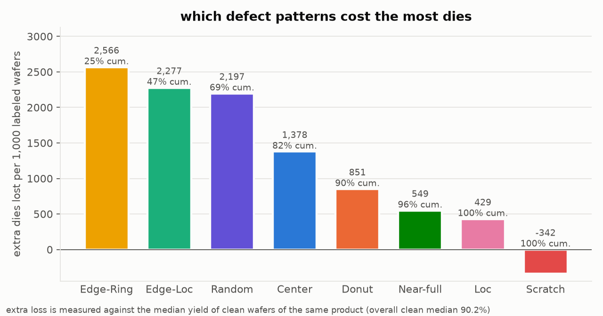

# wm811k

When a fab engineer looks at a wafer bin map, the real question is how many dies it's costing and which tool to check first. What the pattern is called comes second. I used the WM-811K dataset (811,457 production wafer maps, Wu, Jang & Chen, IEEE TSM 2015) to work through that question the way a process or yield engineer would.



Edge-Ring and Edge-Loc cost the most dies, 47% of the excess loss between them. Each bar compares a pattern with clean wafers of the same product.

What I did:

- ranked defect patterns by how much yield they actually destroy
- trained classifiers and tested them the way a fab would use them, split by lot and scored on the rare patterns, with a review gate for the costly mistakes
- linked each pattern to a sourced root-cause table
- tested whether a vision-language model or a physics simulator can replace labelled data
- built an LLM triage assistant and checked every claim it makes with code

Every number below comes from a file in `results/`. Every choice behind it, including the options I turned down, is in [DECISIONS.md](DECISIONS.md).

## How I evaluated it

- I split by lot, not by wafer. Wafers in one lot share tools and timing, so a random wafer split leaks. 187 defect maps also show up as exact copies across lots (93 copy groups), so I merged those lots before splitting and no copy crosses train and test (d13 to d15). That gives about 70/15/15 train, validation and test, with 25,939 labelled test wafers.
- I report macro-F1 and per-class recall, never headline accuracy. 85.2% of test wafers are "none", so a model that never finds a single defect is already 85.2% accurate.
- Confidence intervals resample whole lots (500 lot-bootstrap rounds), because wafers in the same lot aren't independent.
- Each model touched the test set once. Every setting was picked on validation.

## Results

### Yield loss by pattern

I measured excess die loss against the median yield of clean wafers from the same product, using grid size as the product marker (d16, d17). Edge-Ring (25.0% of excess loss), Edge-Loc (22.2%) and Random (21.4%) make up 69% of the dies lost to patterns. Near-full is the worst per wafer, with a median yield of 12%, but it's rare. Scratch wafers lose no dies on net against their product baseline (`results/yield_by_class.csv`, `figures/yield_pareto.png`).

### Lot-level clustering

Every defect pattern piles up inside lots far more than chance would allow. A Donut wafer is 127 times more likely than expected to have a lot-mate with the same pattern, Random 111 times and Edge-Ring 17 times (permutation p < 0.005 for every class). Slot order inside a lot only adds a little on top of that. Loc is the clearest case, at 1.28 times more likely than chance to repeat in the next slot. 502 of 7,025 lots (7.1%) are excursion lots, where one defect pattern covers half or more of the labelled wafers, and 361 of those are Edge-Ring. That points at tools and chambers more than random events (`results/lots_*.csv`, `figures/lots_clustering.png`).

### Classifiers

| Test set, 9 classes | Macro-F1 (95% CI) | Defect wafers passed as clean |
|---|---|---|
| Random forest on 24 engineered features | 0.867 (0.846 to 0.880) | 8.4% |
| Small CNN (0.58M weights), 3 seeds | 0.877 (0.855 to 0.893), seeds 0.877 to 0.884 | 3.7% |

The CNN beats the forest by 0.010 macro-F1, with a paired interval of −0.008 to +0.029. That interval includes zero, so overall neither one is clearly better. Where they really differ is the expensive mistake, a defect wafer called clean. The CNN drops Scratch missed as clean from 27% to 11% and Loc from 20% to 8%, and its recall gains on Loc (+0.18) and Scratch (+0.12) are clear of zero (`results/cnn_minus_rf.csv`, `results/missed_as_none_rf_vs_cnn.csv`, `figures/rf_confusion.png`, `figures/cnn_confusion.png`).

### Review gate

The gate only calls a wafer clean when the model is confident enough, with the threshold picked on validation. With missed defects held near 5%, the forest sends 19.0 clean wafers per 1,000 to review and the CNN sends 10.3. So at the same miss rate the CNN needs about half the review work. If the CNN only decides the 90% of wafers it's surest about, its macro-F1 on those wafers is 0.986 (`results/abstain_operating_points.csv`, `figures/abstain_tradeoff.png`).

### Grad-CAM check

I measured Grad-CAM heat maps on up to 300 correct test wafers per class. For every class except Near-full, much less heat lands outside the wafer than chance would give. For Center it's 3% of the heat against 22% of the image. Near-full sits at about chance (20% against 21%), which makes sense when almost the whole wafer fails. For Scratch, Loc, Edge-Loc and Donut, the heat is concentrated on the failing dies (lift 1.06 to 1.30). For Edge-Ring it sits as a band just inside the edge, which might just be the coarse 8×8 heat-map grid. For Center it's spread out, so I can't say much there (`results/gradcam_summary.csv`, `figures/gradcam_examples.png`).

### Suspect labels

227 test wafers get the same wrong class from both models, and 24 of those get it with at least 0.8 probability from both. I went through all 24 by hand:

- 17 labels were wrong, and both models were right on 16 of them. Most were wafers labelled Loc or Center that only show background fails.
- 4 labels held up, and both models missed a real pattern there (#4 Center, #5 Loc, #8 and #9 Scratch).
- 3 wafers carry two patterns at once, which a single WM-811K label can't describe.

With my corrected labels (mixed wafers dropped), macro-F1 goes from 0.867 to 0.872 for the forest and from 0.877 to 0.881 for the CNN. The original scores stay the headline since only 24 of 25,939 labels changed (`results/label_audit_candidates.csv`, `results/label_rescore_summary.csv`, d64).

### Vision-language model, zero-shot

I ran GPT-6 Luna zero-shot on 180 test wafers (20 per class), the same ones the forest and CNN were scored on:

| Same 180 wafers | Macro-F1 (95% CI) | Clean wafers called defects | Defect wafers called clean | Cost per 1,000 wafers |
|---|---|---|---|---|
| Luna, label names only | 0.452 (0.385 to 0.508) | 20 of 20 | 0% | $0.60 |
| Luna, one rule per label (v1) | 0.451 (0.389 to 0.501) | 20 of 20 | 0.6% | $0.42 |
| Luna, corrected rules (v2) | 0.612 (0.538 to 0.682) | 3 of 20 | 17% | $0.47 |
| Random forest | 0.866 (0.810 to 0.917) | 0 of 20 | 7% | n/a |
| Small CNN | 0.916 (0.866 to 0.953) | 0 of 20 | 2.5% | n/a |

My first rule prompt defined "none" as "only a few fails", and that was wrong for this data. On training lots a clean wafer has a median of 9.9% failing dies, and Luna read that normal background as a Random pattern. The v2 prompt says scattered fails are normal and defines Random as dense, using the training-lot fail shares. On a separate validation sample, v2 raised macro-F1 from 0.410 to 0.563, and only after that did I score it once on test. I only found the problem by looking at test results, so v2 is reported next to v1 and doesn't replace it (d53, d55, d61).

Even with the fix, Luna is far behind a small trained model, so it can't replace labelling here. It's actually best at Scratch, with 20 of 20 on v2 against 11 of 20 for the forest and 15 of 20 for the CNN.

Costs use OpenAI's published gpt-6-luna prices. They're an upper bound, because the codex harness I called it through adds about 15k input tokens to every call (`results/vlm_summary.csv`, d46 to d48).

### Grounded triage assistant

Luna drafts an 8D D2 to D4 first response for a flagged wafer, using the CNN's prediction, the die yield, the product's clean-wafer yield and the lot context. It's told to use only the matching row of the root-cause table. Code checks every reply, with no LLM judge, for process modules the row doesn't support, sources outside the row's tags, numbers that aren't in the facts, named tools and the wrong pattern.

| 54 test wafers + 6 trick questions | All checks pass | Module beyond the table | Outside reference cited | Number not in the facts |
|---|---|---|---|---|
| With the table row | 60 of 60 | 0% | 0% | 0% |
| Without the table (control) | 2 of 60 | 97% | 22% | 7% |

The trick questions ask for a tool ID, a dollar cost, a journal reference for a row that has none, and how many other wafers are affected. With the table, five of the six listed the requested item as unknown. The sixth asked whether implant caused an Edge-Ring. It never named implant and listed the causal step as unknown. Without the table, replies often add lithography, implant or thermal causes for a Center wafer, and some cite lecture or thesis URLs I haven't checked.

So grounding keeps the model inside what the project can back up. That doesn't mean the table is right, since most rows are still hypotheses. The checks also only catch invented specifics, not a weak argument built out of allowed words (`results/assistant_summary.csv`, d49, d50, d60, d62).

### Training on simulated wafers only

I built a process-fault simulator ([docs/simulator.md](docs/simulator.md)) that makes wafer maps from physical fault settings: radial thickness profiles, edge roll-off, particle clouds, scratch paths and Poisson defects. A forest trained on 27,000 simulated maps, with no real labels at all, scores 0.454 macro-F1 (0.422 to 0.473) on the real test set. It catches most defect types (recall of 0.97 for Random, 0.88 for Edge-Ring, 0.76 for Donut and 0.73 for Scratch) and passes only 0.4% of defects as clean. But it calls 51% of real clean wafers defects. Real clean wafers carry weak edge and line structure that independent background fails don't produce, and that's the next thing the simulator needs (`results/synthetic_*.csv`, d51 to d54).

## Root causes

[docs/root_causes.md](docs/root_causes.md) maps each pattern to its likely process modules and physical mechanism, the first fab step to check, and the signal that would confirm the cause. Each row cites a verified source or is marked as an engineering hypothesis. The Edge-Ring, Center and Donut rows draw on my own hands-on spin-coat edge-bead and ALD uniformity work.

## Limits

- The data has no product ID, so I use map grid size as a stand-in for product.
- The labelled wafers lean toward worse ones (median yield 89.4% against 94.8% for unlabelled), so "per 1,000 labelled wafers" isn't a rate for the whole fab.
- Labels may have been assigned lot by lot, which could inflate the lot clustering. The data can't rule that out.
- There are no tool, chamber or recipe fields, so the root-cause table stays a set of hypotheses until someone checks it against real process history.

## Run it

Download `LSWMD.pkl` from the [WM-811K Kaggle page](https://www.kaggle.com/datasets/qingyi/wm811k-wafer-map) and put it in the repository root. It isn't included because of its size.

```bash
python -m venv .venv && source .venv/bin/activate
pip install -e ".[dev]"
pytest
```

Then run the scripts from the repo root in this order. Each one writes to `results/` and `figures/`.

```bash
python scripts/run_audit.py
python scripts/run_split.py
python scripts/run_yield.py
python scripts/run_lots.py
python scripts/run_rf.py
python scripts/run_cnn.py
python scripts/run_abstain.py
python scripts/run_gradcam.py
python scripts/run_label_audit.py
python scripts/run_label_rescore.py
python scripts/run_synthetic.py
python scripts/run_vlm.py
python scripts/run_assistant.py
```

`run_cnn.py` trains on an Apple GPU if there is one and falls back to the CPU. On an Apple M5 each of its four training runs took 30 to 50 minutes. `run_vlm.py` and `run_assistant.py` call GPT-6 Luna through the codex CLI bundled with the ChatGPT desktop app, so they need that installed and signed in. I've only run the whole pipeline on my Mac.

## Layout

- `src/wm811k/` holds all the logic: loading, audit, split, yield, lots, features, simulator, CNN, review gate, VLM and assistant.
- `scripts/run_*.py` each run one analysis.
- `tests/` has 172 pytest checks, including the yield formula, a lot-disjoint split, each feature's physics on simulated wafers and the hallucination checks.
- `config.yaml` holds every seed and threshold.

## License

MIT
