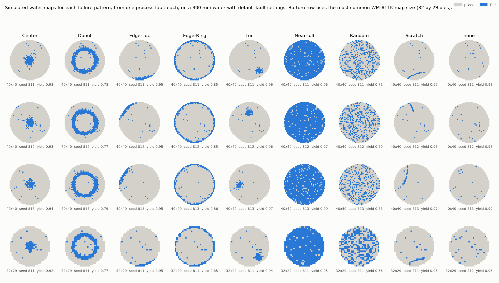

# Process fault simulator

`src/wm811k/simulator.py` generates synthetic wafer maps from parameterised process faults. Each WM-811K class has one generator, keyed by the dataset's exact label string (`Center`, `Donut`, `Edge-Loc`, `Edge-Ring`, `Loc`, `Near-full`, `Random`, `Scratch`, `none`, matching `wm811k.data.CLASSES`). Each generator is driven by physical inputs with units: mm, percent deviation from target, defects per cm², and kill probabilities. Every generator takes a seed and returns the map together with every parameter used, including any positions or angles it drew at random.

This is the F′ piece in RESEARCH.md (decision d06). The point is not to imitate WM-811K pixel for pixel. It is to have maps where the cause is known, so that later work can ask questions like "does the classifier call an off-center edge roll-off edge-loc or edge-ring?" and "how strong does a fault have to be before it is visible against the background?"



Rebuild the figure from the repository root with:

```bash
python scripts/make_simulator_figure.py
```

The seeds (811 to 813) and grid sizes come from the `simulator` section of `config.yaml`. The top three rows use the 40 by 40 grid the default fault settings were tuned on. The bottom row uses 32 by 29 dies, the most common WM-811K map size in `results/audit_map_sizes.csv`.

Code comments tagged `d24` and up point to the matching entries in `DECISIONS.md`.

## Shared model

**Grid.** The wafer is a disc of diameter `wafer_diameter_mm` (default 300 mm) on a grid of `rows` by `cols` dies (default 40 by 40, so the pitch is 7.5 mm and each die is 0.5625 cm²). Rows and columns can differ, which gives rectangular dies. WM-811K maps come in 632 distinct sizes (`results/audit_facts.csv`), and most are not square. A die exists only if all four of its corners fit inside the wafer radius minus `edge_exclusion_mm` (default 3 mm). Partial edge dies are not printed or tested in a real fab, and this rule gives the stepped edge seen on real bin maps.

The WM-811K wafer diameter and die sizes are not known, so 300 mm is an assumption, not a fact about the dataset.

**Map codes.** 0 means no die, 1 pass, 2 fail, the same as the real data. Yield is computed with the project's shared `wm811k.yield_stats.die_yield`, so synthetic and real yields are defined the same way.

**From fault to fail.** Each generator computes a fail probability for every die. A die then fails if its own uniform random number is below that probability. Independent ways to fail combine as `1 - (1 - p_fault)(1 - p_background)`.

**Background.** Every generator except `Random` and `none` adds a small Poisson background (`background_d0_per_cm2`, default 0.02 defects/cm²). Real wafers are never perfectly clean outside a pattern.

**Two random streams.** One seed is split into a layout stream and a die stream. The layout stream picks things like a cluster center or scratch heading. The die stream holds one uniform number per die. Fault strength never changes the die stream, so on the same seed a stronger fault can only add fails, never remove them. The tests rely on this: they check yield monotonicity die by die, not only on average.

**Process window.** The radial and edge generators describe the fault as a local deviation from target in percent, for example film thickness or etch depth. Each die also has its own normal scatter (`die_sigma_pct`). A die fails if it lands outside `±spec_limit_pct`. This is how a parametric yield loss actually happens: the process drifts, and the dies that drift out of the window fail electrically.

## Generators

### Center: `center_fault`

**Physics.** Deposition, etch and CMP rates vary with radius. A center that is too thick, too thin or over-etched comes from things like showerhead gas distribution, CMP carrier head zone pressure, or a center-peaked plasma. The deviation is a gaussian in radius, `peak_deviation_pct · exp(-r² / 2w²)`, with `w = zone_width_mm`.

**Parameters.** `peak_deviation_pct` (9), `zone_width_mm` (30), `spec_limit_pct` (5), `die_sigma_pct` (1.5).

### Donut: `donut_fault`

**Physics.** Same as Center, but the bad zone is a ring at `ring_radius_mm` with a gaussian cross section of width `ring_width_mm`. Physical analogues are a zone boundary in a multi-zone CMP head or heater, or a ring of high plasma density.

**Parameters.** `peak_deviation_pct` (9), `ring_radius_mm` (80), `ring_width_mm` (12), plus the process window inputs.

### Edge-Ring: `edge_ring_fault`

**Physics.** Near the edge, the plasma sheath, gas flow and temperature all change, so rates roll off over the last few mm. The deviation is an exponential in distance from the physical wafer edge, `peak_deviation_pct · exp(-inset / rolloff_length_mm)`, the same all the way round.

**Parameters.** `peak_deviation_pct` (30, the deviation at the physical edge), `rolloff_length_mm` (10).

The peak is large because the outermost complete dies sit about 9 mm or more inside the edge on this grid, where the roll-off has already decayed.

### Edge-Loc: `edge_loc_fault`

**Physics.** The same edge roll-off, but confined to part of the edge. Two mechanisms can confine it, and they can be used together:

1. **A local edge feature** (`arc_width_deg`, default 25°). A clamp finger, gas inlet, lift pin near the edge, or a local edge bead problem affects only an arc. The roll-off is multiplied by a gaussian in angle centered on `angle_deg`.
2. **Off-center placement** (`placement_offset_mm`, default 0). The chamber's edge zone is sized for a centered wafer. A shifted wafer pushes one side deeper into that zone and pulls the other side out. With `arc_width_deg=None`, this is the only source of asymmetry, which makes a thin crescent.

The design point is that Edge-Ring and Edge-Loc share one mechanism and differ only in symmetry. That gives a concrete question for later: where does a classifier draw the line as the arc gets wider?

**Parameters.** `peak_deviation_pct` (30), `rolloff_length_mm` (15), `angle_deg` (drawn from the seed if not given), `arc_width_deg` (25), `placement_offset_mm` (0).

### Loc: `loc_fault`

**Physics.** A flake or particle burst lands as a cloud, not as single points. The cloud is a 2D gaussian of particle density around one center, holding `particle_count` particles on average. Only a fraction `kill_ratio` of particles land on a critical feature and kill a die. Yield engineers measure that fraction by overlaying inspection maps on bin maps. The expected number of killers in each die is the share of the gaussian that falls inside the die's square, computed exactly with error functions. A die fails with probability `1 - exp(-expected killers)`, which is Poisson. This matches the "local defects as a bivariate normal" framing in Hwang and Kuo (2007) at abstract level (see `root_causes.md`, S5).

**Parameters.** `particle_count` (150), `cluster_sigma_mm` (12), `kill_ratio` (0.4), `center_x_mm` and `center_y_mm` (drawn from the seed if not given, within about 74% of the radius so the result reads as Loc rather than Edge-Loc).

### Scratch: `scratch_fault`

**Physics.** Something dragged across the surface cuts a narrow track. A straight line fits a robot blade or a wafer sliding in a cassette. An arc fits debris trapped under a CMP pad, because the wafer and pad both rotate. Any die whose square footprint the track crosses is at risk. A crossed die fails with probability `kill_probability`, because scratch depth varies and contact skips.

**Parameters.** `length_mm` (140), `arc_radius_mm` (220; `None` gives a straight line), `scratch_width_mm` (0.5), `kill_probability` (0.85), `start_x_mm`, `start_y_mm` and `heading_deg` (drawn from the seed if not given).

### Random: `random_defects`

**Physics.** Killer defects with no spatial preference follow a Poisson process, so die yield is `exp(-A · D0)`. That is the textbook Poisson yield model. Real fabs see the defect density change from wafer to wafer. Setting `cluster_alpha` draws each wafer's density from a gamma distribution with mean `d0_per_cm2` and shape `alpha`. Averaged over wafers, this gives the negative binomial yield model, `(1 + A·D0/α)^-α`. Small α means large swings between wafers. This is a wafer-level mixture only; within one wafer the defects stay uniform (see limitations).

**Parameters.** `d0_per_cm2` (0.6), `cluster_alpha` (None, meaning plain Poisson).

### none: `no_pattern`

**Physics.** A healthy wafer with only a low random background (`d0_per_cm2`, default 0.03). It uses the same model as `Random` at a lower density. The line between the two classes is a threshold, not a different mechanism.

### Near-full: `near_full_fault`

**Physics.** A gross, wafer-level failure: a skipped step, the wrong recipe, an implant dose error. It is not spatial, so every die gets the same fail probability `kill_probability` (default 0.92). The few dies that survive by chance are what separate Near-full from a fully dead wafer.

### Mixing faults: `combine`

`combine(a, b, ...)` puts several simulated faults on one wafer. A die fails if any of the faults failed it. Real wafers often carry more than one pattern; mixed-type maps are the subject of S1 and S6 in `root_causes.md`. Give each component a different seed, otherwise they share die draws and are not independent.

## What the simulation gets wrong

These are known simplifications. Each is a place where real maps will look different, and where a classifier trained on these maps could pick up the wrong cues.

- **Default strengths are illustrative, not calibrated.** No default parameter value comes from fab data or a paper. They were tuned by eye so that each class is visible on a 40-die grid. Real yields, pattern sizes and pattern frequencies are not represented.
- **One fault per map, applied to a perfect process.** Real wafers have a radial profile that is never flat, several weak signatures at once, and lot-to-lot drift. `combine` adds faults together but does not model how they interact.
- **The process window is one symmetric spec on one parameter.** Real dies fail on many parameters at once, with asymmetric limits and correlated failures. `die_sigma_pct` is the same everywhere, but in a real fab, within-die and die-to-die variation often grows toward the edge.
- **Pass and fail only.** Real bin maps have many bin codes that point to different failure modes. WM-811K reduces them to pass and fail, and so does this simulator.
- **Die fails are independent given the fail probability.** Real defects cluster within a wafer at every scale. The negative binomial option only spreads density between wafers. It does not make defects cluster on one wafer.
- **Edge roll-off is an exponential.** Real edge profiles can overshoot (a thick bead followed by a thin zone) or change sign. The edge-loc arc shape (a gaussian in angle) is a convenient form, not one derived from any real clamp or inlet geometry.
- **Off-center placement offsets needed for a visible crescent are large.** Without a local arc, a clear one-sided band needs several mm of offset. Typical robot placement accuracy was not checked, and may be much tighter.
- **Scratches are a single smooth path with independent kills.** Real scratches can be intermittent in long runs, come in parallel sets, or curve irregularly. The arc model also ignores the real CMP kinematics that would set the curvature.
- **Particle clusters are round.** Real clusters from a flake or a spray can be streaked, comet-shaped, or follow gas flow.
- **Near-full is uniform.** Real gross failures often keep a gradient or a surviving zone, which can make them look like center or edge patterns at lower severity.
- **No reticle structure.** Real products print several dies per reticle field and leave some sites as untested test structures. Reticle-level repeaters, which are a real litho pattern, cannot be produced.
- **No test artifacts.** Probe card faults, tester drift and contact problems can produce patterns that look like process faults. None are modelled.
- **Defaults were tuned on one grid.** Any rows by cols works, but the default strengths were tuned by eye on 40 by 40. On a coarser grid each die is bigger, so the same defect density gives lower yield (see `Random` in the bottom row of the figure). That part is correct physics. But how visible the edge patterns are also changes with how far the outer dies sit from the edge, and that part is a grid artifact. Matching the WM-811K size mix for a synthetic-to-real test is not done yet.
